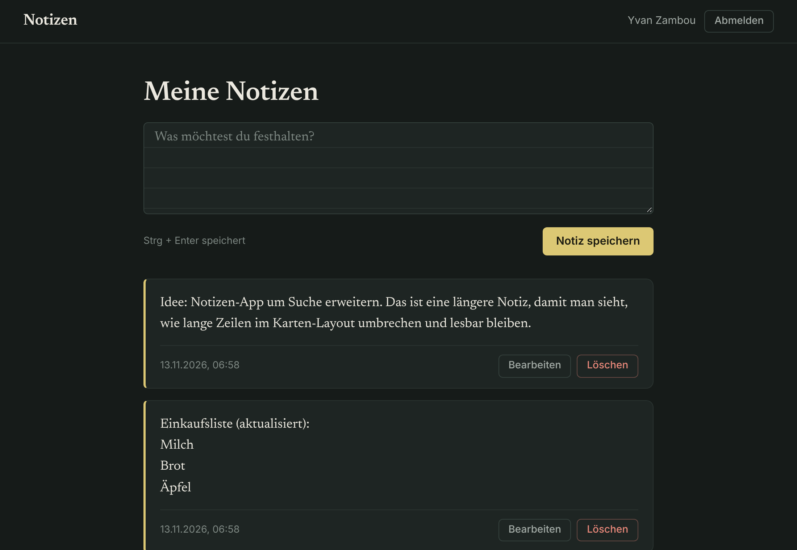

# PHP User Notes App


Notizen-App mit Registrierung, Login und persönlicher Notizverwaltung (anlegen, bearbeiten, löschen).
Reines PHP ohne Framework, dafür mit sauberer Schichtung, PDO mit Prepared Statements, CSRF-Schutz
und einem Docker-Setup (PHP/Apache + MariaDB).

<p align="center">
  
</p>

## Funktionen

- Registrierung mit **Name, Benutzername, E-Mail-Adresse und Passwort**
- Serverseitige Validierung, u. a. der E-Mail-Adresse (Syntax, Länge, gültige Domain-Endung, Duplikate)
- Login per Benutzername **oder** E-Mail, Passwörter als Hash (`password_hash` / `password_verify`)
- Notizen anlegen, **bearbeiten** und löschen – jeder sieht und ändert nur seine eigenen
- Dunkles Theme, responsives Layout, ohne externe Ressourcen (Schrift selbst gehostet)

## Schnellstart

Voraussetzung: Docker mit Compose.

```bash
cp .env.example .env        # Passwörter in .env anpassen
docker compose up -d --build
```

Danach läuft die App unter <http://localhost:8080>. Das Datenbankschema wird beim ersten Start
automatisch aus `database/schema.sql` angelegt.

| Befehl | Wirkung |
|---|---|
| `docker compose logs -f app` | Logs der Anwendung |
| `docker compose down` | Container stoppen (Daten bleiben erhalten) |
| `docker compose down -v` | Container stoppen **und Datenbank löschen** (Schema wird beim nächsten Start neu angelegt) |
| `docker compose -f docker-compose.yml up -d --build` | Produktionsnah starten, ohne Entwicklungs-Override |

> **Nach dem Update von einer älteren Version:** Das Schema hat sich geändert (`users.password` →
> `users.password_hash`, neue Spalten `name`, `updated_at`, Notizen gehören per `user_id` zum Benutzer).
> Bestehende Entwicklungsdaten bitte mit `docker compose down -v` verwerfen.

## Konfiguration

Alles läuft über Umgebungsvariablen aus der `.env` (Vorlage: `.env.example`). Die `.env` ist in
`.gitignore` eingetragen und gehört **nie** ins Repository.

| Variable | Bedeutung | Standard |
|---|---|---|
| `APP_ENV` | `development` zeigt Fehlermeldungen an, `production` nicht | `production` |
| `APP_PORT` | Port auf dem Host | `8080` |
| `APP_TIMEZONE` | Zeitzone für die Anzeige (gespeichert wird in UTC) | `Europe/Berlin` |
| `DB_NAME`, `DB_USER`, `DB_PASS` | Datenbank und App-Benutzer | – |
| `DB_ROOT_PASSWORD` | Root-Passwort der Datenbank (nur der DB-Container bekommt es) | – |

## Projektstruktur

```
├── public/               Einziges Web-Root: Einstiegsseiten + Assets
│   ├── index.php, login.php, register.php, logout.php
│   ├── notes.php, note-edit.php, note-delete.php, healthz.php
│   └── assets/           css, js, fonts, img
├── src/                  Anwendungslogik (Namespace App\)
│   ├── Repository/       Datenbankzugriff (UserRepository, NoteRepository)
│   ├── Validation/       Eingabeprüfung (Registrierung, Notizen)
│   └── Auth, Csrf, Session, Flash, View, Http, Config, Database
├── templates/            HTML-Templates (Layout + Seiten)
├── database/schema.sql   Datenbankschema (MariaDB)
├── docker/               PHP- und Apache-Konfiguration
├── tests/                PHPUnit-Tests (Repositories gegen MariaDB)
├── Dockerfile            Mehrstufig: base → vendor → runtime
└── docker-compose.yml    app + db (+ docker-compose.override.yml für die Entwicklung)
```

## Entwicklung

Alles läuft im Container, die Tests gegen eine echte MariaDB:

```bash
docker compose up -d --build                 # Entwicklungs-Image (Composer + PHPUnit)
docker compose exec app composer lint        # Syntaxprüfung aller PHP-Dateien
docker compose exec app composer test        # PHPUnit gegen die Datenbank "<DB_NAME>_test"
```

Die Test-Datenbank (`notes_test`) wird beim ersten Start des DB-Containers angelegt und vor jedem Test
mit dem Schema aus `database/schema.sql` neu aufgebaut – die Entwicklungsdaten bleiben unberührt.
Ohne erreichbare Datenbank überspringen die Repository-Tests sich selbst; die Validierungstests laufen immer.
Wurde das DB-Volume vor dieser Änderung angelegt, einmal `docker compose down -v` ausführen, damit die Test-Datenbank entsteht.

Im Entwicklungs-Setup (`docker compose up` nimmt `docker-compose.override.yml` automatisch dazu) werden
`public/`, `src/` und `templates/` live in den Container eingebunden – Änderungen sind sofort sichtbar.
Die Datenbank ist zusätzlich unter `127.0.0.1:3307` erreichbar.

`composer.lock` bitte einmal mit `composer update` erzeugen und committen, damit Builds reproduzierbar sind.

## Sicherheit

- Passwörter: `password_hash()` (bcrypt/argon je nach PHP), automatisches Rehash beim Login
- Login in gleichbleibender Zeit, auch bei unbekanntem Benutzer; neue Session-ID nach dem Login
- SQL-Injection: ausschließlich Prepared Statements mit echten (nicht emulierten) Parametern
- CSRF-Token in allen schreibenden Formularen, Abmelden und Löschen nur per POST
- Notizen sind immer an `user_id` gebunden; fremde Notizen liefern 404
- Ausgaben werden escaped; Content-Security-Policy ohne Inline-Skripte oder externe Quellen
- Apache: Document Root `public/`, keine Verzeichnislisten, versteckte Dateien gesperrt, keine Versionsangaben
- Secrets nur über Umgebungsvariablen; die App bekommt nicht das Root-Passwort der Datenbank

## Autor

**Yvan Zambou** · [LinkedIn](https://linkedin.com/in/yvan-zambou-29aba9261) · [GitHub](https://github.com/yvanzambou)
